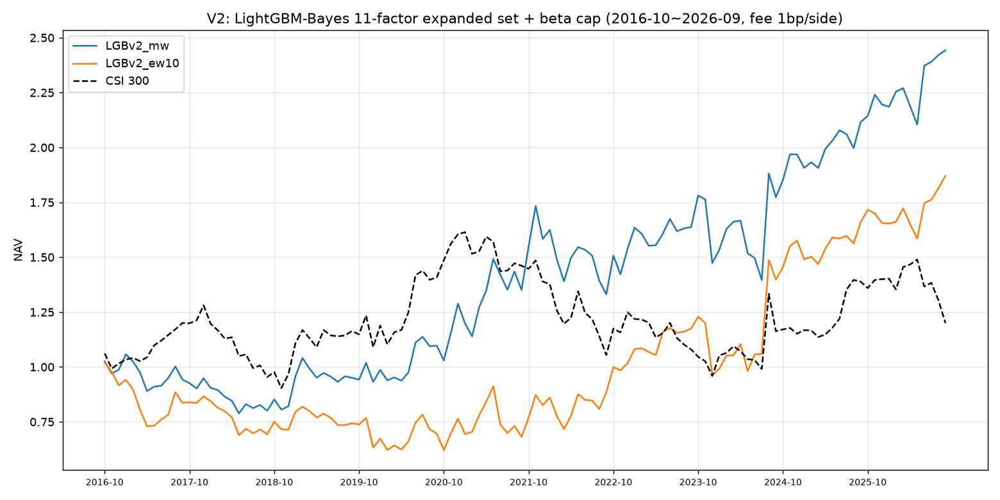

# LightGBM-Factor-Model-Construction

This is a report hoping to exam the actual effect of pure machine learning in current A stock market with data obtained from Tushare ranging from 2018.1 to 2026.10

## Final Result (walk-forward version, 2020-01 ~ 2026-10)

Monthly retraining + monthly Bayesian hyperparameter retuning, 11-factor LightGBM, Top20 constrained Markowitz / Top10 equal-weight, fee 1bp/side:


| Portfolio | Ann. Return | Sharpe | Max Drawdown | Win Rate | Rank IC (mean) |
|---|---|---|---|---|---|
| LGBv2_mw (Top20 Markowitz) | **16.4%** | **0.72** | -19.6% | 58.0% | 0.0416 (ICIR 0.39) |
| LGBv2_ew10 (Top10 equal-weight) | 6.7% | 0.38 | -29.3% | 53.1% | 0.0416 (ICIR 0.39) |
| CSI 300 (benchmark) | 1.4% | 0.17 | -40.6% | 50.6% | — |

Full-window (2016-10 ~ 2026-10) result with fixed hyperparameter calibration:



## Repository Structure

```
├── paper/       referenced paper (PDF + text extracts of factor/method sections)
├── src/         backtest code: 3 versions + comparison script
├── results/     monthly returns / holdings / metrics (JSON+CSV) for each version
├── figures/     NAV charts and comparison charts
└── reports/     summary docs (per version), hyperparameter sensitivity analysis,
                 and factor definitions & mathematical forms (docx)
```

## Key Documents

- **Factor definitions & mathematical forms**: [reports/paper_v2因子计算方式与数学形式.docx](reports/paper_v2因子计算方式与数学形式.docx)
- **Walk-forward version summary**: [reports/backtest_report_paperv2_2020wf.md](reports/backtest_report_paperv2_2020wf.md)
- **Hyperparameter calibration-window sensitivity analysis** (motivation for walk-forward): [reports/hyperparameter_sensitivity_note.md](reports/hyperparameter_sensitivity_note.md)
- **Three-version comparison** (fixed-calibration vs walk-forward, same 2020-2026 window): [figures/compare_2020_window.png](figures/compare_2020_window.png)

## Versions

| Version | Signal Window | Training/Tuning | MW Sharpe | Note |
|---|---|---|---|---|
| `paperv2` | 2016-10 ~ 2026-09 | annual retrain, one-time bayes calibration | 0.50 | full-window baseline |
| `paperv2_2020` | 2020-01 ~ 2026-09 | annual retrain, one-time bayes calibration | 0.30 | demonstrates calibration-window sensitivity |
| `paperv2_2020wf` | 2020-01 ~ 2026-09 | **monthly retrain + monthly retune** | **0.72** | final version, best risk-adjusted performance |

All backtests: A-shares ex ST / BSE / new listings / suspended, PIT financials (ann_date+1), hfq (post-adjusted) prices, t+1 open execution with one-word limit rules, transaction fee 1bp per side. Data source: local quantitative database built from Tushare/Sina; monthly-level inputs cached as parquet. Reproducing a full run takes ~20-30 min on the cached data.

*Referenced paper: Li, Xu, Li (2022), Procedia Computer Science 214:1234-1240 — 5-minute price-volume factors + LightGBM stock selection.*
