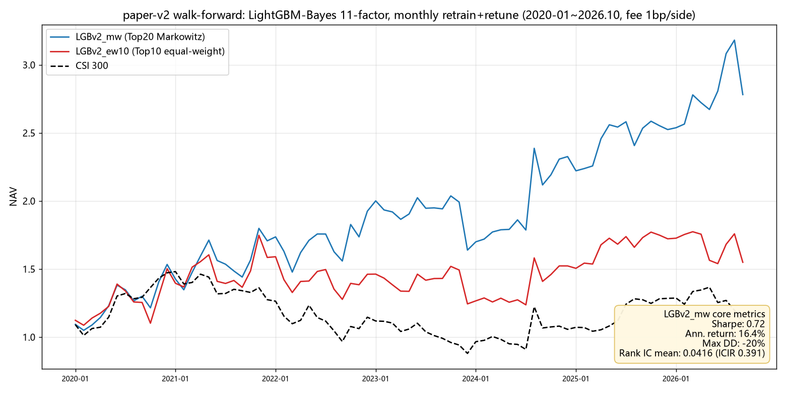
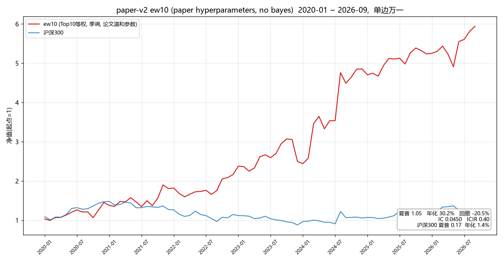

# LightGBM-Factor-Model-Construction

This is a report hoping to exam the actual effect of pure machine learning in current A stock market with data obtained from Tushare ranging from 2018.1 to 2026.10

## Final Result (2020-01 ~ 2026-10)

Walk-forward LightGBM-Bayes stock selection: **monthly retraining + monthly Bayesian hyperparameter retuning** on a trailing 12-month window (lagged 13 months for label realization, no look-ahead), Top20 constrained Markowitz (monthly) and Top10 equal-weight (quarterly) portfolios, fee 1bp/side:



| Portfolio | Ann. Return | Sharpe | Max Drawdown | Win Rate | Rank IC (mean) |
|---|---|---|---|---|---|
| LGBv2_mw (Top20 Markowitz) | **16.4%** | **0.72** | -19.6% | 58.0% | 0.0416 (ICIR 0.39, t=3.52) |
| LGBv2_ew10 (Top10 equal-weight) | 6.7% | 0.38 | -29.3% | 53.1% | 0.0416 (ICIR 0.39, t=3.52) |
| CSI 300 (benchmark) | 1.4% | 0.17 | -40.6% | 50.6% | — |

GRS test: stat=7.69, p=0.001 — the linear factor model cannot explain portfolio returns (significant non-linear alpha).

## Robustness Check: Original Paper Hyperparameters (2020-01 ~ 2026-09)

Given that our bayesian parameters is only optimized with 12 mouths of scrolling data which might be slightly overfitting, hence, we also adopt original parameters procured from the referenced paper. Chart below is the corresponding results (same 11 factors and Top10 equal-weight / quarterly-rebalance scheme, fixed Table 5 hyperparameters, annual October retraining, fee 1bp/side):



| Portfolio | Ann. Return | Sharpe | Max Drawdown | Win Rate | Rank IC (mean) |
|---|---|---|---|---|---|
| LGBv2-paper_hp_ew10 (Top10 equal-weight) | **30.2%** | **1.05** | -20.5% | 61.7% | 0.0450 (ICIR 0.40, t=3.59) |
| CSI 300 (benchmark) | 1.4% | 0.17 | -40.6% | 50.6% | — |

The fixed paper hyperparameters (stronger regularization: reg_alpha=1.0, reg_lambda=1.45, subsample=0.764) outperform the Bayesian-tuned ones in this window — the 12-month rolling tuning window tends to overfit recent noise.

## Factor Definitions (11 factors)

All factors are cross-sectionally winsorized (1%/99%) and then z-score standardized. Financial factors are made point-in-time via an asof join on the first-disclosure version (`f_ann_date`, enforced at ann_date+1). TTM = sum of the last four single-quarter values (single-quarter = within-year YTD difference, Q1 = itself). Market cap (`total_mv`) is in units of 10k CNY and converted (×1e4) before valuation ratios.

| 类别 | 因子 | 计算方式 | 口径要点 |
|---|---|---|---|
| 估值 | **PS** 市销率 | PS = MV / Rev_TTM | 无单位倍数 |
| 估值 | **PCF** 市现率 | PCF = MV / OCF_TTM（仅 OCF_TTM > 0） | 现金流为负置 NULL |
| 估值 | **EP** 盈利收益率 | EP = 1 / PE_TTM | 亏损股 PE 为空 → EP 自动剔除 |
| 成长 | **OR_YoY** 营收同比(TTM) | Rev_TTM(t) / Rev_TTM(t−4) − 1 | 条件 Rev_TTM(t−4) > 0 |
| 成长 | **NP_YoY** 归母净利同比(TTM) | NP_TTM(t) / NP_TTM(t−4) − 1 | 无正值约束，扭亏极端值靠 winsorize 兜底 |
| 盈利质量 | **ROA** 总资产净利率(TTM) | NP_TTM / TA × 100% | 用当期期末总资产（非期初期末均值口径） |
| 盈利质量 | **OPM** 营业利润率(TTM) | (Rev_TTM − TotalCost_TTM) / Rev_TTM × 100% | 注意区分营业利润率与毛利率 |
| 盈利质量 | **Accrual** 应计 | (NP_TTM − OCF_TTM) / TA × 100% | Sloan(1996) 利润质量因子，负值=现金流质量好 |
| 量价 | **REVS20** 20日反转 | −(P̃_t / P̃_{t−20} − 1) | P̃ 为后复权价，动量取负 |
| 量价 | **STD60** 60日波动率 | σ₆₀(日收益) × √244 | 60 日内有效观测 ≥ 40，否则 NULL |
| 量价 | **TURN20** 20日换手率 | (1/20) Σ turnover_{t−k} | Tushare 统一口径 |

Style factors (used only in the Markowitz box constraints, not as model features): **SIZE** = −ln(circulating market cap); **beta250** = 250-day rolling OLS slope against CSI 300 daily returns (≥200 observations), used to cap portfolio beta bets.

## Repository Structure

```
├── paper/     referenced paper (PDF)
├── src/       backtest code (walk-forward version + paper-hyperparameter 2020 version)
├── results/   monthly returns (CSV) / holdings & style exposure (JSON) / metrics incl. monthly tuning history (JSON)
└── figures/   NAV chart with core-metric annotations
```

## Methodology in Brief

- Universe: all A-shares ex ST / Beijing Stock Exchange / new listings (<370 days) / suspended; PIT financials with ann_date+1 enforcement (first-disclosure versions to avoid restatement look-ahead)
- Prices: post-adjusted (hfq), executed at t+1 open with one-word limit-up/down rules
- Label: sign of forward 12-month post-adjusted return (referenced-paper convention); the training window strictly lags the signal month by 13 months so all training labels are fully realized
- Model: LightGBM with monthly Bayesian hyperparameter retuning (15 gp_minimize calls on a 12k subsample, 3-fold CV, objective = mean of Precision/Recall/Accuracy/AUC)
- Portfolios: Top20 Markowitz with industry (10%) / style (35%) / single-stock (12%) / beta box constraints, 0.5% rebalance threshold; Top10 equal-weight rebalanced quarterly
- Factor origin: 5 kept from the referenced paper's significant set (OR_YoY / NP_YoY / ROA / PS / PCF) + 6 from our 16-factor system's significant set (EP / TURN20 / STD60 / REVS20 / Accrual / OPM)
- Data source: local quantitative database built from Tushare/Sina; monthly inputs cached as parquet. Full run takes ~22 min on cached data

*Referenced paper: Li, Xu, Li (2022), Procedia Computer Science 214:1234-1240 — 5-minute price-volume factors + LightGBM stock selection.*
